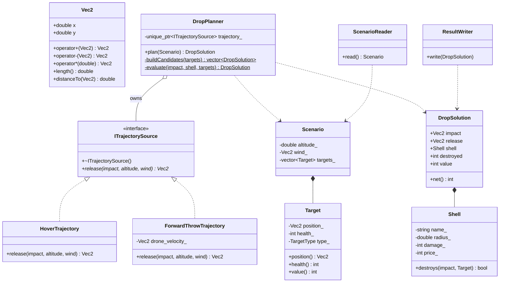

# drone-drop-targeting

Targeting core for a drone-based munition release system. Given a scenario —
release height, wind, and a list of targets — it picks the best shell and
aim point, computes the release point with the selected trajectory model,
and writes the outcome to a file.

## Usage

```
g++ -std=c++17 -Wall -Wextra -O2 main.cpp -o drop_calc
./drop_calc --input-file <scenario.txt> --output-file <result.txt> [--trajectory hover|forward]
```

| Argument | Meaning |
|---|---|
| `--input-file <file>` | input scenario |
| `--output-file <file>` | result file |
| `--trajectory hover\|forward` | trajectory model, default `hover` |

## Trajectory models

Fall time: `t = sqrt(2 * altitude / g)`, `g = 9.81`.

- **hover** (default) — the drone hovers; the shell free-falls and drifts with
  the wind only: `release = impact - wind * t`.
- **forward** — the drone drops on the move at `v_drone = (12.0, 0.0)` m/s; the
  shell inherits the drone's velocity: `release = impact - (wind + v_drone) * t`.

The trajectory model only affects the `release` line of the output.

## Input format

```
<altitude_m>
<wind_x> <wind_y>
<count>
<x> <y> <hp> <type>      # repeated count times
```

`type` is one of `PERSONNEL`, `LOGISTICS`, `APC`, `TANK`, `RADAR` — each
worth a fixed value (10 / 20 / 40 / 60 / 90).

## Output format

```
<impact_x> <impact_y>
<release_x> <release_y>
<shell_name>
<destroyed> <value_sum> <price> <net>
```

The calculation time (reading and writing files excluded) goes to stdout only:

```
elapsed_us <integer>
```

## Example

`input/mission-a.txt`:
```
120.0
5.0 0.0
4
300.0 400.0 20 LOGISTICS
300.0 450.0 15 PERSONNEL
260.0 380.0 15 PERSONNEL
340.0 380.0 15 PERSONNEL
```

`--trajectory hover` (default):
```
300.00 400.00
275.27 400.00
Frag
4 50 35 15
```

`--trajectory forward`:
```
300.00 400.00
215.91 400.00
Frag
4 50 35 15
```

## Class diagram



## Project layout

```
main.cpp                 CLI parsing, trajectory selection, wiring
include/vec2.h           Vec2 with overloaded +, -, * scalar
include/trajectory.h     ITrajectorySource + HoverTrajectory + ForwardThrowTrajectory
include/mission.h        Target, Shell, Scenario
include/drop_planner.h   DropPlanner: candidates + std::max_element with isWorse comparator
include/scenario_io.h    ScenarioReader, ResultWriter
input/                   course scenarios (mission-*, large-5000) + own (custom-*)
expected/                expected outputs for large-5000 (hover / forward)
run-all.sh               builds (if stale) and runs every input/*.txt
```

## Best-solution selection

1. `buildCandidates` builds every `aim target × shell` pair with its consequences,
   targets in input order, shells in table order (Frag, HE, HEAT).
2. `std::max_element(candidates, isWorse)` picks the best. `isWorse(a, b)`:
   lower net is worse; on equal net the more expensive shell is worse.
   `max_element` returns the first of equally best elements, so on a full tie
   the earlier candidate wins without an extra condition.

## Complexity

Let `N` be the number of targets and `S` the number of shell types.
Each of the `N` targets is tried as an aim point with each of the `S` shells,
and for every pair all `N` targets are checked for coverage:

- coverage checks: `N × S × N` → **O(S · N²)**, with `S = 3` constant → **O(N²)**;
- `max_element` over `N × S` candidates → O(N), negligible;
- memory: `N × S` candidates → O(N).

Doubling the targets roughly quadruples the time.

## Measured time

Apple M1 Pro, Apple clang 17, `-std=c++17 -Wall -Wextra`:

| Scenario | Targets | `-O2` | `-O0` |
|---|---|---|---|
| mission-a … mission-e, custom-a … custom-c | 1–6 | 0–1 µs | 2–6 µs |
| large-5000 | 5 000 | ~49 000 µs | ~970 000 µs |

Budget for 5 000 targets: 1 s with `-O2`, 5 s without optimizations — both met.

```
./drop_calc --input-file input/large-5000.txt --output-file result.txt
diff result.txt expected/large-5000-hover.txt && echo OK
```

## Batch run

```
./run-all.sh                         # hover
TRAJECTORY=forward ./run-all.sh      # forward
```

Results go to `output/<name>-result.txt`.

## Docker

```
docker build -t drop-calc .
docker run --rm -v "$PWD/output:/app/output" drop-calc
docker run --rm -e TRAJECTORY=forward -v "$PWD/output:/app/output" drop-calc
```

## Control questions

1. **Why is `push_back` amortized O(1)?** When capacity runs out the vector
   reallocates to a geometrically larger buffer (×1.5–2) and moves everything — O(n).
   Those expensive calls get exponentially rarer, so the total cost of `n` pushes
   is O(n), i.e. O(1) per call on average.
2. **When do iterators/pointers get invalidated?** After any reallocation
   (`push_back`/`insert`/`reserve` exceeding capacity) — elements move to a new
   buffer and the old one is freed. `insert`/`erase` also invalidate everything
   after the position, since those elements shift.
3. **Comparator returns `true` for equal elements?** It breaks strict weak
   ordering (irreflexivity) — undefined behavior. `max_element` would replace the
   current best with each later equal one and return the last instead of the first;
   `sort` may read out of bounds or crash.
4. **How does "first of the best" replace the HW3 tie-break?** Candidates are built
   in HW3 order and the comparator says "not worse" for full ties, so `max_element`
   keeps the earlier one. The explicit "keep existing on equality" check disappears.
5. **Why is `unique_ptr` copy forbidden at compile time?** The copy constructor and
   assignment are `= delete`d. Single ownership is a property of the type, so the
   compiler rejects a second owner — no runtime cost and no chance of a double free
   at run time. Ownership is transferred explicitly with `std::move`.
6. **3 → 30 shells / 10× targets?** O(S · N²): 10× shells → ~10× work (still O(N²)
   as S is a constant). 10× targets → ~100× work.
7. **Why a monotonic clock?** `steady_clock` never goes backwards; `system_clock`
   can jump on NTP sync or manual changes, giving wrong or negative durations.
8. **Why can `-O0` mislead?** Unoptimized code is dominated by overhead that the
   optimizer removes (no inlining, every variable in memory, abstraction cost of
   iterators/accessors). The ratio between two algorithms may differ a lot from the
   one in the real `-O2` build — measure what you ship.
