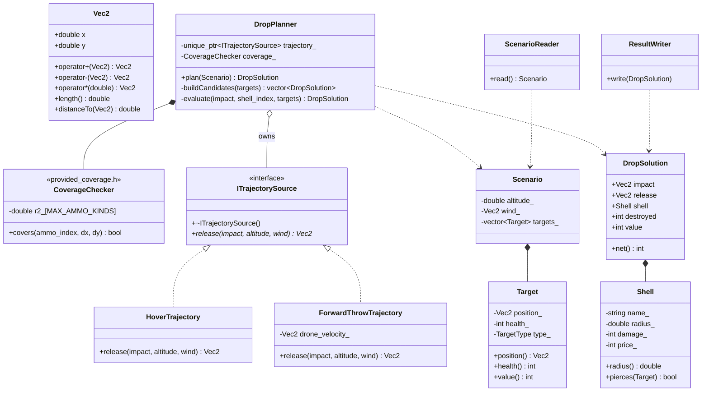

# drone-drop-targeting

Targeting core for a drone-based munition release system. Given a scenario —
release height, wind, and a list of targets — it picks the best shell and
aim point, computes the release point with the selected trajectory model,
and writes the outcome to a file.

## Build

CMake ≥ 3.16. One project description, three build variants:

```
# Debug: -g, no optimizations (for gdb / lldb / valgrind)
cmake -S . -B build-debug   -DCMAKE_BUILD_TYPE=Debug   && cmake --build build-debug

# Release: -O3, use it for timing
cmake -S . -B build-release -DCMAKE_BUILD_TYPE=Release && cmake --build build-release

# Diagnostics: AddressSanitizer + UndefinedBehaviorSanitizer (option, OFF by default)
cmake -S . -B build-asan    -DCMAKE_BUILD_TYPE=Debug -DENABLE_SANITIZERS=ON \
                            && cmake --build build-asan
```

Targets:

- `drop_core` — static library: data model, best-solution search, trajectory models,
  coverage check. No `main`, no file I/O. Exposes `core/include` as a `PUBLIC`
  include directory, so anything linking it gets the headers without `-I`.
- `drop_calc` — thin CLI: argument parsing, scenario reading, calling the core,
  writing the result, printing the elapsed time.

Sanitizer flags are attached to `drop_core` as `PUBLIC` compile *and* link options, so
they propagate to `drop_calc` too — the whole program is instrumented and the sanitizer
runtime is linked.

## Usage

```
./build-release/drop_calc --input-file <scenario.txt> --output-file <result.txt> [--trajectory hover|forward]
```

| Argument | Meaning |
|---|---|
| `--input-file <file>` | input scenario |
| `--output-file <file>` | result file |
| `--trajectory hover\|forward` | trajectory model, default `hover` |

## Trajectory models

Fall time: `t = sqrt(2 * altitude / g)`, `g = 9.81`.

- **hover** (default) — the drone hovers; the shell free-falls and drifts with
  the wind only: `release = impact - wind * t`.
- **forward** — the drone drops on the move at `v_drone = (12.0, 0.0)` m/s; the
  shell inherits the drone's velocity: `release = impact - (wind + v_drone) * t`.

The trajectory model only affects the `release` line of the output.

## Input format

```
<altitude_m>
<wind_x> <wind_y>
<count>
<x> <y> <hp> <type>      # repeated count times
```

`type` is one of `PERSONNEL`, `LOGISTICS`, `APC`, `TANK`, `RADAR` — each
worth a fixed value (10 / 20 / 40 / 60 / 90).

## Output format

```
<impact_x> <impact_y>
<release_x> <release_y>
<shell_name>
<destroyed> <value_sum> <price> <net>
```

The calculation time (reading and writing files excluded) goes to stdout only:

```
elapsed_us <integer>
```

Empty scenario (`count` = 0): nothing to aim at, so the core rejects it
(`DropPlanner::plan` precondition — throws `std::invalid_argument`). The program
prints `empty scenario` to stderr, exits with code `1` and creates no output file.

## Example

`input/mission-a.txt`:
```
120.0
5.0 0.0
4
300.0 400.0 20 LOGISTICS
300.0 450.0 15 PERSONNEL
260.0 380.0 15 PERSONNEL
340.0 380.0 15 PERSONNEL
```

`--trajectory hover` (default):
```
300.00 400.00
275.27 400.00
Frag
4 50 35 15
```

`--trajectory forward`:
```
300.00 400.00
215.91 400.00
Frag
4 50 35 15
```

## Class diagram



## Project layout

```
CMakeLists.txt                     targets drop_core + drop_calc, ENABLE_SANITIZERS option
core/include/vec2.h                Vec2 with overloaded +, -, * scalar
core/include/trajectory.h          ITrajectorySource + HoverTrajectory + ForwardThrowTrajectory
core/include/mission.h             Target, Shell, Scenario
core/include/provided_coverage.h   CoverageChecker (provided by the lecturer, off-by-one fixed)
core/include/drop_planner.h        DropPlanner, DropSolution, isWorse
core/src/drop_planner.cpp          candidates + std::max_element, coverage via CoverageChecker
app/main.cpp                       CLI parsing, trajectory selection, timing, wiring
app/scenario_io.h                  ScenarioReader, ResultWriter (file I/O lives in the app only)
input/                             course scenarios (mission-*, large-5000) + own (custom-*)
input/edge/                        edge scenarios: edge-single, edge-empty
expected/                          expected output for every scenario, hover and forward
scripts/check.sh                   runs all scenarios × both models against expected/ + empty case
run-all.sh                         builds Release (if stale) and runs every input/*.txt
```

## Best-solution selection

Coverage: instead of `distance <= radius`, `CoverageChecker` precomputes squared
radii once and checks `dx² + dy² <= r²`. Both sides are non-negative, so squaring
keeps the order — results are byte-identical to the previous version.

1. `buildCandidates` builds every `aim target × shell` pair with its consequences,
   targets in input order, shells in table order (Frag, HE, HEAT).
2. `std::max_element(candidates, isWorse)` picks the best. `isWorse(a, b)`:
   lower net is worse; on equal net the more expensive shell is worse.
   `max_element` returns the first of equally best elements, so on a full tie
   the earlier candidate wins without an extra condition.

## Complexity

Let `N` be the number of targets and `S` the number of shell types.
Each of the `N` targets is tried as an aim point with each of the `S` shells,
and for every pair all `N` targets are checked for coverage:

- coverage checks: `N × S × N` → **O(S · N²)**, with `S = 3` constant → **O(N²)**;
- `max_element` over `N × S` candidates → O(N), negligible;
- memory: `N × S` candidates → O(N).

Doubling the targets roughly quadruples the time.

## Measured time

Apple M1 Pro, Apple clang 17, `-std=c++17 -Wall -Wextra` (`-O2` ≈ Release build):

| Scenario | Targets | `-O2` | `-O0` |
|---|---|---|---|
| mission-a … mission-e, custom-a … custom-c | 1–6 | 0–1 µs | 2–6 µs |
| large-5000 | 5 000 | ~49 000 µs | ~970 000 µs |

Budget for 5 000 targets: 1 s with `-O2`, 5 s without optimizations — both met.

```
./build-release/drop_calc --input-file input/large-5000.txt --output-file result.txt
diff result.txt expected/large-5000-hover.txt && echo OK
```

## Diagnostics

```
scripts/check.sh build-release/drop_calc   # all scenarios × hover/forward vs expected/, + empty case
scripts/check.sh build-asan/drop_calc      # same under ASan + UBSan
valgrind --leak-check=full --track-origins=yes \
    ./build-debug/drop_calc --input-file input/mission-a.txt --output-file /tmp/result.txt
```

On macOS 26 the Apple clang ASan runtime hangs at startup, and Valgrind is not
available — run diagnostics in the course container
(`lectures/lesson-17-debugging/Dockerfile`):

```
docker run --rm -it -v "$PWD":/work -w /work miltech-debug bash
```

Status: in the diagnostic build all scenarios (both models, including `edge-single`
and `edge-empty`) pass with no sanitizer reports; Valgrind Memcheck reports
`0 errors`, no leaks on every scenario except large-5000 (skipped, too slow under
Memcheck). The one defect found — an off-by-one in `provided_coverage.h` — is fixed.

## Batch run

```
./run-all.sh                         # hover
TRAJECTORY=forward ./run-all.sh      # forward
```

Results go to `output/<name>-result.txt`. Edge scenarios in `input/edge/` are not
part of the batch (the empty one exits with `1` by design) — `scripts/check.sh` covers them.

## Docker

```
docker build -t drop-calc .
docker run --rm -v "$PWD/output:/app/output" drop-calc
docker run --rm -e TRAJECTORY=forward -v "$PWD/output:/app/output" drop-calc
```

## Control questions

1. Vector has capacity bigger than size. When it is full, it allocates new bigger
   memory (around 2x) and copies all elements there, this is slow. But it happens
   not often, so if we count all push_backs together, one call is O(1) on average.
2. When vector reallocates memory (push_back or insert when capacity is full, or
   reserve). Elements go to new place and old memory is freed, so old pointers point
   to nothing. Also insert and erase break iterators after that position, because
   elements are shifted.
3. Then comparator is wrong, it is undefined behavior. For max_element it will take
   the last equal element and not the first one. Algorithms like sort can even crash.
4. Candidates are built in same order like in HW3. For equal elements comparator
   returns false, so max_element keeps the first one. So we dont need separate
   if for this case.
5. Because unique_ptr has deleted copy constructor and copy assignment. Compiler
   sees it and gives error, so two owners of one object is not possible and there is
   no double delete. To give ownership we use std::move.
6. Complexity is O(S * N^2). If shells 3 -> 30, work is 10 times more, but it is
   still O(N^2) because S is constant. If targets 10 times more, work is 100 times more.
7. System time can change (NTP sync or user changes it), so the result can be wrong
   or even negative. steady_clock always goes forward.
8. Without optimizations compiler does not inline functions and keeps variables
   in memory, so a lot of time is overhead and not the algorithm. Difference between
   two algorithms can be not the same like in -O2 build, so better to measure the
   real build.
