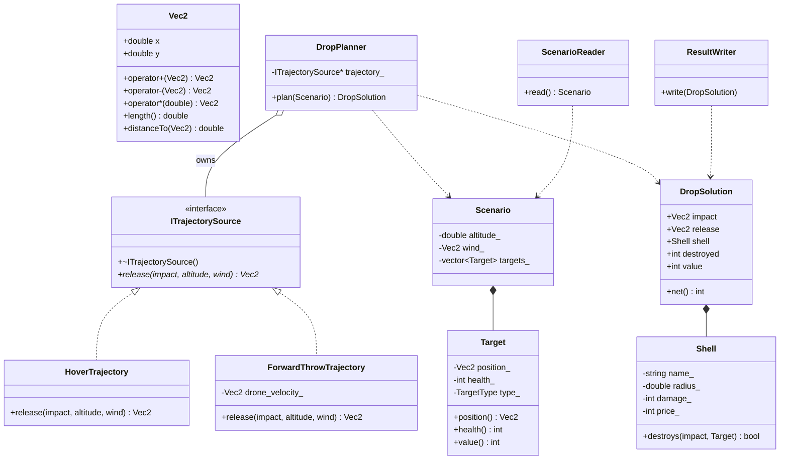

# drone-drop-targeting

Targeting core for a drone-based munition release system. Given a scenario —
release height, wind, and a list of targets — it picks the best shell and
aim point, computes the release point with the selected trajectory model,
and writes the outcome to a file.

## Usage

```
g++ -std=c++17 -Wall -Wextra -O2 main.cpp -o drop_calc
./drop_calc --input-file <scenario.txt> --output-file <result.txt> [--trajectory hover|forward]
```

| Argument | Meaning |
|---|---|
| `--input-file <file>` | input scenario |
| `--output-file <file>` | result file |
| `--trajectory hover\|forward` | trajectory model, default `hover` |

## Trajectory models

Fall time: `t = sqrt(2 * altitude / g)`, `g = 9.81`.

- **hover** (default) — the drone hovers; the shell free-falls and drifts with
  the wind only: `release = impact - wind * t`.
- **forward** — the drone drops on the move at `v_drone = (12.0, 0.0)` m/s; the
  shell inherits the drone's velocity: `release = impact - (wind + v_drone) * t`.

The trajectory model only affects the `release` line of the output.

## Input format

```
<altitude_m>
<wind_x> <wind_y>
<count>
<x> <y> <hp> <type>      # repeated count times
```

`type` is one of `PERSONNEL`, `LOGISTICS`, `APC`, `TANK`, `RADAR` — each
worth a fixed value (10 / 20 / 40 / 60 / 90).

## Output format

```
<impact_x> <impact_y>
<release_x> <release_y>
<shell_name>
<destroyed> <value_sum> <price> <net>
```

## Example

`input/mission-a.txt`:
```
120.0
5.0 0.0
4
300.0 400.0 20 LOGISTICS
300.0 450.0 15 PERSONNEL
260.0 380.0 15 PERSONNEL
340.0 380.0 15 PERSONNEL
```

`--trajectory hover` (default):
```
300.00 400.00
275.27 400.00
Frag
4 50 35 15
```

`--trajectory forward`:
```
300.00 400.00
215.91 400.00
Frag
4 50 35 15
```

## Class diagram



## Project layout

```
main.cpp                 CLI parsing, trajectory selection, wiring
include/vec2.h           Vec2 with overloaded +, -, * scalar
include/trajectory.h     ITrajectorySource + HoverTrajectory + ForwardThrowTrajectory
include/mission.h        Target, Shell, Scenario
include/drop_planner.h   DropPlanner (shell / aim point selection, unchanged from HW3)
include/scenario_io.h    ScenarioReader, ResultWriter
input/                   course scenarios (mission-*) + own (custom-*)
run-all.sh               builds (if stale) and runs every input/*.txt
```

## Batch run

```
./run-all.sh                         # hover
TRAJECTORY=forward ./run-all.sh      # forward
```

Results go to `output/<name>-result.txt`.

## Docker

```
docker build -t drop-calc .
docker run --rm -v "$PWD/output:/app/output" drop-calc
docker run --rm -e TRAJECTORY=forward -v "$PWD/output:/app/output" drop-calc
```
